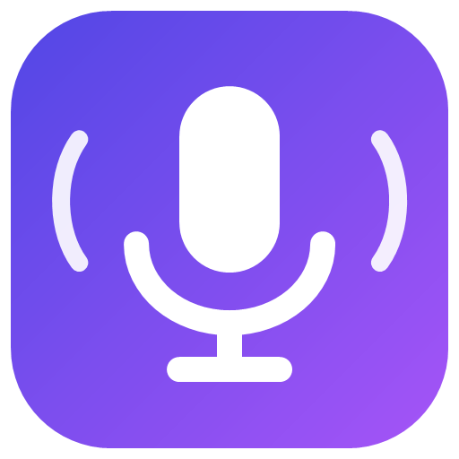

<p align="center"></p>

# Windows Voice Assistant

Talk to your Windows PC: dictate into any app like [Wispr Flow](https://wisprflow.ai), and control apps hands-free with “Hey Jarvis”.

Everything runs **on this PC**. Speech is transcribed locally with [whisper.cpp](https://github.com/ggerganov/whisper.cpp) (via [Whisper.net](https://github.com/sandrohanea/whisper.net)) and filtered with the Silero voice-activity model; audio and transcripts are never written to disk or sent anywhere.

## Install

Requirements: Windows 10/11 (ARM64 or x64), a microphone, ~700 MB disk. No administrator rights.

```powershell
git clone https://github.com/shivam098/windows-voice-assistant.git
cd windows-voice-assistant
powershell -ExecutionPolicy Bypass -File .\scripts\install.ps1
```

The installer builds a self-contained app, downloads the speech and voice-activity models once (SHA-256 verified), installs to `%LOCALAPPDATA%\Programs\VoiceAssistant`, adds a **Voice Assistant** Start menu shortcut, and starts it. Look for the purple microphone in the system tray and the status pill at the bottom of the screen.

| Option | Effect |
|---|---|
| `-StartAtSignIn` | Start automatically when you sign in (also a tray menu toggle) |
| `-Model ggml-base.en-q8_0.bin` | Faster, less accurate model (default: `ggml-small.en-q8_0.bin`) |
| `-NoLaunch` | Install without starting |

Uninstall: `.\scripts\uninstall.ps1` (add `-RemoveData` to delete models, settings, and logs).

## Share it (portable zip)

Friends don't need to install anything:

```powershell
.\scripts\package.ps1                  # dist\VoiceAssistant-<version>-win-x64.zip and -win-arm64.zip (~70 MB each)
.\scripts\package.ps1 -IncludeModels   # also bundles the speech models (~340 MB) for offline use
```

They unzip it, double-click `VoiceAssistant.exe` (the app isn't code-signed, so Windows SmartScreen asks once: *More info → Run anyway*), and the speech models download on first run (~265 MB, SHA-256 verified). `README-FIRST.txt` in the zip explains the shortcuts. Use **win-x64** for Intel/AMD PCs and **win-arm64** for Snapdragon/ARM PCs. Ready-made zips are attached to the [GitHub releases](https://github.com/shivam098/windows-voice-assistant/releases).

The speech engine needs the Microsoft Visual C++ runtime. Release zips bundle it (built by `.github/workflows/release.yml` on a clean Windows runner whenever a `v*` tag is pushed), so friends need nothing else. Locally, `package.ps1` bundles it when Visual Studio or Build Tools with the C++ workload is installed, and warns otherwise.

## 1. Dictate anywhere (Wispr-style)

Put the cursor in any text box, then:

| Do | Result |
|---|---|
| **Hold `Ctrl`+`Win`**, speak, release | Your words are inserted at the cursor |
| **`Ctrl`+`Win`+`Space`** | Hands-free dictation; press again to insert |
| **`Esc`** while recording | Cancel |
| **`Alt`+`Shift`+`Z`** | Paste the last dictation again |

Dictation is cleaned up automatically:

- **Filler words** (“um”, “uh”, “hmm”) are removed.
- **Spoken punctuation**: “comma”, “question mark”, “exclamation mark”, “colon”, “new line”, “new paragraph”, and “period” at the end.
- **Inline correction**: “…call John, scratch that, email Sarah” keeps only what follows “scratch that” (it drops the phrase just before it).
- **Personal dictionary**: `replacements` fixes words and names you use (“git hub” → “GitHub”, “shivum” → “Shivam”).
- **Snippets**: say a trigger (or “insert *trigger*”) to type saved text, e.g. a signature.
- Text is **pasted** (reliable in every app). It is kept out of Clipboard History and cloud clipboard, and your previous clipboard is restored.

## 2. Voice control — “Hey Jarvis”

The assistant waits for **“Hey Jarvis”**. After the wake word, commands work without it for **30 seconds** (each command extends this). If you say a command without the wake word, the pill reminds you to say “Hey Jarvis” first; other speech is ignored silently. Short tones play when it wakes and when typing starts/stops.

Speak naturally — polite padding is understood: *“Hey Jarvis, can you open Notepad?”*, *“Could you please open Chrome for me”*, *“I want to start typing”*, *“fire up Chrome”*. Misheard app names are tolerated (“notpad”, “crome”, “outlook” → “Outlook (new)”).

**It learns from you:** if it doesn't understand something and you rephrase it within 30 seconds, it remembers the first phrase for next time (*“Got it — next time ‘get notepad going’ will do that too.”*). It only learns when both phrases share a meaningful word (like the app name), and prefers the apps you open most when a name is ambiguous. Learned phrases stay on this PC in `%APPDATA%\VoiceAssistant\learned.json`; tray → *Forget what I've learned* clears them.

| Say | Does |
|---|---|
| “Open Notepad” / “Open Chrome” / “Open GitHub Copilot” | Opens the app. **Notepad opens a fresh window** (never types into your open document) |
| “Switch to Notepad” / “Go back to Chrome” | Brings the existing window to the front |
| “Start typing” | Starts dictation in the app’s text area — Notepad’s document, Copilot’s message box, a browser’s address/search bar (or the page text box you clicked) |
| “Hey Jarvis, open Notepad and start typing” | Both at once |
| “Go to the search box” | Browsers: the address/search bar. Other apps: the box labelled “search”. Then dictate your query |
| “Go to the address bar” | Browsers |
| “Search for weather in Bangalore” | Focuses search, types, presses Enter |
| “New tab”, “Close tab”, “Go back”, “Refresh”, “Scroll down” | Browser/app shortcuts |
| “Copy”, “Paste”, “Cut”, “Undo”, “Redo”, “Select all”, “Save” | Editing shortcuts |
| “Press enter / tab / escape / up / down / page down …” | Any of those keys |
| “Pause listening” | Turns the microphone off |

**While typing** (red pill), everything you say is typed. Pause briefly, then say a command on its own:

| Say | Does |
|---|---|
| “Send” / “Search” / “Submit” | Presses the app’s send key (Enter), then back to commands |
| “Scratch that” | Deletes the last phrase |
| “Clear box” | Clears the text box |
| “New line” / “New paragraph” | Line break without sending |
| “Press tab” (any key) | Presses it |
| “Stop typing” | Back to commands; nothing is sent |

“Please send me the logs” is typed; a standalone “Send.” sends. Start with “Hey Jarvis, …” to force a command while typing.

**Example flows**

```text
"Hey Jarvis, open Notepad"  →  "Start typing"  →  "Dear team comma …"  →  "Stop typing"
"Hey Jarvis, open Chrome"   →  "New tab"  →  "Go to the search box"  →  "weather in Bangalore"  →  "Search"
"Hey Jarvis, open GitHub Copilot and start typing"  →  "Fix the failing test"  →  "Send"
```

**Status pill:** light blue = waiting for “Hey Jarvis”, blue = listening for a command, red = typing/dictating, grey = paused. `Ctrl+Alt+Space` or a left-click on the tray icon pauses/resumes listening; push-to-talk works even while paused.

## Safety and privacy

- **Bound to one window.** Voice dictation goes only to the window where you said “start typing”. If focus moves, nothing is typed or sent; the text is kept in memory (tray → *Copy text that wasn't typed*).
- **Refuses** password fields and windows running as administrator. Voice dictation also refuses fields it can't verify; push-to-talk (an explicit key press) allows them.
- **Whole-utterance commands only**: a sentence containing “send” never sends. Low-confidence commands are ignored.
- **Music and noise are dropped** by Silero before transcription; long speech while waiting for a command (meetings) is skipped.
- Runs unelevated. Logs (`%LOCALAPPDATA%\VoiceAssistant\logs`, kept 7 days) contain only states and timings — never words.
- No speaker identification: anyone near the microphone can say “Hey Jarvis”. Pause listening in meetings.

## Settings

`%APPDATA%\VoiceAssistant\settings.json` (tray → *Open settings file*; restart to apply):

| Setting | Default | |
|---|---|---|
| `wakeWordEnabled` / `wakeWords` / `awakeSeconds` | `true` / “hey jarvis”… / `30` | Wake word behaviour |
| `learnFromUsage` | `true` | Learn rephrasings and app usage (`learned.json`) |
| `soundFeedback` | `true` | Tones on wake, typing start/stop, push-to-talk |
| `pushToTalk` | `true` | `Ctrl+Win` dictation keys |
| `pasteLastHotkey` | `Alt+Shift+Z` | |
| `insertMethod` | `Paste` | `Type` sends keystrokes instead (some apps drop characters) |
| `removeFillerWords` / `spokenPunctuation` | `true` | Dictation clean-up |
| `replacements` | git hub → GitHub, … | Whole-word fixes |
| `snippets` | `{}` | e.g. `{ "my signature": "Thanks,\nShivam" }` |
| `modelFile` | `ggml-small.en-q8_0.bin` | In `%LOCALAPPDATA%\VoiceAssistant\models` |
| `endSilenceMs` | `600` | Pause that ends a phrase |
| `maxCommandUtteranceMs` | `6000` | Longer speech while waiting for a command is skipped |
| `hotkey` | `Ctrl+Alt+Space` | Pause/resume listening |
| `apps` | Copilot, Notepad, Chrome, Edge, Firefox | Per-app launch, `submitKeys`, `newLineKeys`, `textArea` (`Bottom`/`Largest`), `textAreaName`, `searchKeys`, `newWindowKeys`, `newDocumentKeys` |

## How it works

```text
Microphone ─┬─ (Ctrl+Win held) ─────────────► capture ─► Silero chunks ─► Whisper ─► format ─► paste at cursor
            └─ UtteranceSegmenter (pauses) ─► Silero (drop noise, split) ─► Whisper ─► CommandParser
                                                                                    ─► InteractionController
                                                                                    ─► Win32 + UI Automation
```

| Project | Purpose |
|---|---|
| `src/VoiceAssistant.Core` | Parser, wake word, formatter, segmenter, controller — platform-independent, unit-tested |
| `src/VoiceAssistant.Speech` | Whisper and Silero wrappers |
| `src/VoiceAssistant.App` | Tray app, overlay, microphone, key hook, clipboard paste, UI Automation |
| `tests/VoiceAssistant.Core.Tests` | xUnit tests |
| `tools/SpeechBench` | Benchmarks, live microphone diagnostics, noisy-room replay |

## Develop

```powershell
dotnet test tests/VoiceAssistant.Core.Tests
dotnet build src/VoiceAssistant.App -r win-arm64        # or win-x64

# Desktop self-test: runs scripted transcripts against real apps (no microphone)
src\VoiceAssistant.App\bin\Debug\net10.0-windows\win-arm64\VoiceAssistant.exe --self-test script.txt out.txt

# Speech tools
dotnet run --project tools/SpeechBench -c Release -r win-arm64 -- --live 30            # live mic diagnostics
dotnet run --project tools/SpeechBench -c Release -r win-arm64 -- --mix noise.wav -22  # commands over room noise
```

Regenerate the logo with `powershell -File assets\make-logo.ps1`. See the **[step-by-step guide](docs/GUIDE.md)** (install, use, share, develop, contribute), [docs/BENCHMARKS.md](docs/BENCHMARKS.md), [docs/PRD.md](docs/PRD.md), and [docs/TECHNICAL-SPEC.md](docs/TECHNICAL-SPEC.md).

## Known limitations

- English only. A headset works best in noisy rooms.
- Inline “scratch that” is rule-based: it removes the phrase before it, not a single corrected word (“meet at 2, scratch that, 3” keeps only “3”). Wispr's AI rewrites, tones/styles, and command-mode editing need a language model and aren't included.
- Voice dictation inserts text after each pause (~1 s), not word by word. Push-to-talk inserts when you release the keys.
- `Ctrl+Win` combinations used by Windows (e.g. `Ctrl+Win+D`) still work; the recording is discarded.
- Plain “Copilot” opens the Start menu app named *Copilot* (Microsoft Copilot). Say “GitHub Copilot”.
